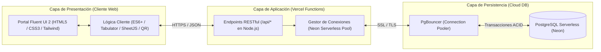

<div align="center">
  

  <h1>AvantiForms</h1>
  <p><strong>Sistema Corporativo de Gestión de Activos TI y Emisión de Actas Digitales</strong></p>
  <p><em>Agrícola Avanti S.A.C. · Departamento de Tecnologías de la Información</em></p>

  <p>
    
    
    
    
    
    
  </p>
</div>

---

## Tabla de Contenidos

1. [Resumen Ejecutivo](#1-resumen-ejecutivo)
2. [Módulos y Capacidades Funcionales](#2-módulos-y-capacidades-funcionales)
3. [Arquitectura del Sistema y Stack Tecnológico](#3-arquitectura-del-sistema-y-stack-tecnológico)
4. [Modelo de Datos e Integridad Transaccional](#4-modelo-de-datos-e-integridad-transaccional)
5. [Especificación de Servicios API](#5-especificación-de-servicios-api)
6. [Estructura del Proyecto](#6-estructura-del-proyecto)
7. [Configuración y Despliegue](#7-configuración-y-despliegue)
8. [Gobernanza, Seguridad y Trazabilidad](#8-gobernanza-seguridad-y-trazabilidad)
9. [Propiedad Intelectual](#9-propiedad-intelectual)

---

## 1. Resumen Ejecutivo

**AvantiForms** es la plataforma web empresarial del **Departamento de Tecnologías de la Información de Agrícola Avanti S.A.C.**, concebida para centralizar, estandarizar y auditar el ciclo de vida operativo del parque tecnológico corporativo.

La solución reemplaza la gestión documental física tradicional por un flujo digital trazable de extremo a extremo que abarca la **asignación, custodia, devolución, reingreso a stock y baja patrimonial** de activos informáticos y de telecomunicaciones. Cada operación queda respaldada en la nube con firmas manuscritas electrónicas, registro fotográfico optimizado e instantáneas técnicas inmutables para fines de control interno y auditoría.

---

## 2. Módulos y Capacidades Funcionales

### 2.1. Emisión Estandarizada de Actas Digitales
El motor documental unifica cuatro formatos normativos adaptados a la naturaleza técnica de cada activo corporativo:

| Categoría Patrimonial | Identificador Técnico | Alcance de Registro |
| :--- | :--- | :--- |
| **Equipos Informáticos (PCs / Laptops)** | `material_informatico` | Código patrimonial, N.º de serie, CPU, memoria RAM, almacenamiento, licenciamiento (Windows, Office, Antivirus, Correo) y periféricos adjuntos. |
| **Periféricos y Monitores** | `perifericos` | Tipo de hardware, marca/modelo, N.º de serie, dimensiones en pulgadas, interfaces de video y cables/adaptadores de energía. |
| **Teléfonos Móviles Corporativos** | `telefonos` | Terminal móvil, N.º de serie, IMEI 1 / IMEI 2, capacidad de almacenamiento, color y accesorios de protección/carga. |
| **Chips y Líneas Móviles** | `lineas` | Número telefónico corporativo, código ICCID (SIM), operador de telecomunicaciones y control de estado (`ACTIVA` / `SUSPENDIDA`). |

**Funcionalidades operativas integradas en cada acta:**
- **Firma Electrónica Manuscrita Cuádruple:** Captura táctil y por puntero sobre lienzo `HTML5 Canvas` para el especialista de Soporte TI y el colaborador receptor, tanto en el acto de **Entrega** como en el de **Devolución** (incluyendo soporte formal para devoluciones efectuadas por terceros).
- **Escaneo Óptico QR / Código de Barras:** Integración con cámara mediante `html5-qrcode` conectada al motor de búsqueda inteligente para recuperar y autocompletar instantáneamente el historial técnico del activo.
- **Evidencia Fotográfica Optimizada:** Procesamiento y compresión automática en cliente (`Canvas JPEG`) para adjuntar sustento visual del estado físico del equipo al entregarse o recepcionarse.
- **Maquetación Institucional A4 / PDF:** Diseño de impresión calibrado para generar documentos oficiales en una sola página A4 listos para exportación nativa a PDF o archivo físico.

### 2.2. Consola de Inventario General y Reportería Ejecutiva
- **Visibilidad Consolidada en Tiempo Real:** Cálculo automático de indicadores operativos clave (**Activos/Operativos**, **En Stock** e **Inactivos/Retirados**) sobre la totalidad de las categorías.
- **Grilla Empresarial de Alto Rendimiento:** Implementada con **Tabulator 5.5**, ofrece navegación segmentada por pestañas (*Pivot Tabs*), filtrado multicriterio instantáneo por código patrimonial, serie o colaborador asignado, paginación local y diseño adaptable para consulta en campo.
- **Auditoría Documental Directa:** Acceso inmediato desde cada registro a la reimpresión del acta vigente y al visor modal de evidencia fotográfica.
- **Exportación Corporativa:** Generación directa de reportes estructurados en formato **Microsoft Excel (`.xlsx`)** mediante **SheetJS**, respetando la segmentación activa.

### 2.3. Directorio Corporativo de Personal
- **Gestión Maestra de Colaboradores:** Administración CRUD completa del padrón de personal (DNI, nombre completo, departamento/área, cargo, correo corporativo y centro de costos).
- **Asignación Ágil:** Integración mediante parámetros seguros entre el directorio y el módulo de actas para pre-cargar automáticamente los datos filiatorios del empleado receptor.

### 2.4. Centro de Administración y Experiencia de Usuario (UX)
- **Sistema de Diseño Microsoft Fluent UI 2:** Interfaz inspirada en *Microsoft 365 Admin Center*, priorizando claridad jerárquica, legibilidad tipográfica y reducción de carga cognitiva.
- **Tematización Dual Sincronizada:** Soporte nativo para **Modo Oscuro** y **Modo Claro** con persistencia local, prevención de parpadeo en carga inicial (*Zero-FOUC*) y sincronización en tiempo real entre pestañas abiertas.
- **Accesibilidad y Estados de Carga:** Atributos semánticos `ARIA`, navegación por teclado y previsualización estructural mediante *Fluent Skeletons*.

---

## 3. Arquitectura del Sistema y Stack Tecnológico

La plataforma adopta una arquitectura **Serverless Cloud-Native** desacoplada, garantizando alta disponibilidad, escalabilidad automática bajo demanda y mantenimiento operativo reducido.



### Stack Tecnológico

| Capa | Tecnología / Librería | Propósito en la Plataforma |
| :--- | :--- | :--- |
| **Interfaz y Diseño** | HTML5, CSS3 Custom Properties, Tailwind CSS | Maquetación responsiva, variables de tema claro/oscuro y sistema visual **Fluent UI Design 2**. |
| **Componentes Cliente** | Vanilla JavaScript (ES6+), Tabulator `5.5.0` | Gestión de estado de sesión, tablas de datos interactivas, firmas en `Canvas` y compresión de imágenes. |
| **Utilidades de Captura y Datos** | `html5-qrcode`, SheetJS (`xlsx 0.20.0`) | Lectura de códigos de barras/QR por cámara y exportación nativa de inventarios a libros de Excel. |
| **Backend Serverless** | Node.js sobre **Vercel Serverless Functions** | Ejecución distribuida de servicios API RESTful sin administración de servidores dedicados. |
| **Base de Datos y Driver** | **Neon PostgreSQL**, `@neondatabase/serverless`, `pg`, `ws` | Almacenamiento relacional e híbrido (`JSON`) con soporte WebSocket y *connection pooling* optimizado. |

---

## 4. Modelo de Datos e Integridad Transaccional

El esquema de persistencia combina **normalización relacional** para las entidades maestras con **instantáneas técnicas en JSON** para preservar fielmente las condiciones exactas en las que se entregó o devolvió un activo en cualquier punto del tiempo:

1. **Entidades Administrativas y de Personal:**
   - `usuarios_admin`: Credenciales y roles de acceso al portal administrativo.
   - `empleados`: Padrón corporativo de colaboradores vinculados a centros de costo y áreas operativas.
   - `notificaciones_tribu`: Bandeja de alertas operativas asociadas a los usuarios del sistema.
2. **Catálogos Maestros de Activos:**
   - `pcs` (Equipos de cómputo y portátiles), `tef` (Terminales móviles), `perifericos` (Monitores y accesorios) y `lineas_moviles` (Servicios SIM/ICCID).
3. **Trazabilidad Documental e Instantáneas (`Snapshots`):**
   - `actas_asignacion`: Registro maestro que consolida fechas, observaciones, evidencias fotográficas y las cuatro firmas electrónicas con validación de DNI.
   - `detalle_acta_pc`, `detalle_acta_tef`, `detalle_acta_periferico`, `detalle_acta_linea`: Tablas históricas vinculadas que almacenan `detalles_json` (especificaciones de hardware/software) y `accesorios_json` bajo bloques transaccionales estrictos (`BEGIN` / `COMMIT` / `ROLLBACK`).

---

## 5. Especificación de Servicios API

Todos los servicios residen en el directorio `/api` y se despliegan automáticamente como funciones *serverless* independientes:

| Endpoint | Método(s) | Descripción Operativa |
| :--- | :---: | :--- |
| `/api/auth` | `POST` | Valida credenciales contra `usuarios_admin` y retorna el contexto de sesión y rol del operador. |
| `/api/registro` | `POST` | Registra nuevas cuentas administrativas verificando unicidad de correo corporativo. |
| `/api/guardar-acta` | `POST` | Ejecuta una transacción ACID integral: *upsert* del activo y su estado operativo, *upsert* del empleado, emisión del acta maestra y guardado de la instantánea técnica. |
| `/api/obtener-equipo` | `GET` | Motor de búsqueda transversal insensible a mayúsculas por N.º de serie, código patrimonial, IMEI, número telefónico o ICCID. |
| `/api/obtener-metricas` | `GET` | Unifica el inventario global cruzando cada activo con su última acta emitida y calcula los KPIs ejecutivos (`stock`, `operativo`, `retirados`). |
| `/api/empleados` | `GET`, `POST`, `PUT`, `DELETE` | Operaciones CRUD completas sobre el directorio de personal, con desvinculación transaccional segura en actas históricas al eliminar registros. |
| `/api/eliminar-registro` | `POST` | Elimina de forma atómica un activo y su historial de detalles asociado garantizando ausencia de registros huérfanos. |
| `/api/notificaciones` | `GET`, `POST` | Consulta las últimas alertas operativas del usuario y gestiona el marcado individual o masivo de lectura. |

---

## 6. Estructura del Proyecto

```text
AvantiForms/
├── api/                          # Capa de servicios Backend (Vercel Serverless Functions)
│   ├── db.js                     # Pool global PostgreSQL/Neon con inyección automática de PgBouncer (-pooler)
│   ├── auth.js                   # Servicio de autenticación corporativa
│   ├── registro.js               # Alta de operadores administrativos
│   ├── guardar-acta.js           # Transacción maestra de emisión/actualización de actas e inventario
│   ├── obtener-equipo.js         # Búsqueda inteligente de activos multi-categoría
│   ├── obtener-metricas.js       # Consolidación de inventario general y cálculo de KPIs
│   ├── empleados.js              # API RESTful del directorio de colaboradores
│   ├── eliminar-registro.js      # Baja transaccional controlada de equipamiento
│   └── notificaciones.js         # Servicio de notificaciones de usuario
├── index.html                    # Portal de inicio de sesión y acceso en modo auditoría/invitado
├── dashboard.html                # Centro de Administración de TI (Hub principal M365 / Fluent 2)
├── gestion-actas.html            # Motor de formularios, firmas digitales, escáner QR e impresión A4
├── inventario.html               # Consola de inventario general, filtros dinámicos y exportación Excel
├── admin-empleados.html          # Módulo administrativo del directorio de personal
├── app.js                        # Núcleo cliente: control de sesión, tematización sin FOUC y utilidades UI
├── styles.css                    # Hoja de estilos corporativa basada en Microsoft Fluent UI Design 2
├── AVANTI LOGO (1).jpeg          # Identidad gráfica institucional de Agrícola Avanti S.A.C.
└── package.json                  # Manifiesto de dependencias y metadatos del proyecto
```

---

## 7. Configuración y Despliegue

### 7.1. Requisitos Previos
- **Node.js** `v18.x` o superior.
- **Gestor de paquetes** `npm` (incluido con Node.js).
- Instancia activa de base de datos **PostgreSQL** (optimizado nativamente para **Neon Serverless Postgres**).
- **Vercel CLI** (`npm i -g vercel`) para emulación local de funciones *serverless* y despliegue continuo.

### 7.2. Variables de Entorno
Cree un archivo `.env` en la raíz del proyecto (o configure las variables en el panel de **Vercel Project Settings > Environment Variables**):

```env
# Cadena de conexión PostgreSQL con SSL requerido
DATABASE_URL="postgresql://<usuario>:<password>@<endpoint>.neon.tech/<nombre_bd>?sslmode=require"
```

> **Nota de Ingeniería:** El módulo `api/db.js` detecta automáticamente endpoints de Neon (`.neon.tech`) y habilita el enrutamiento por **PgBouncer (`-pooler`)** junto con el caché de conexiones en invocaciones calientes (*warm starts*), previniendo el agotamiento de conexiones en picos de concurrencia.

### 7.3. Instalación y Ejecución en Desarrollo

```bash
# 1. Clonar el repositorio corporativo
git clone https://github.com/moralesruizbrayan-create/AvantiForms.git
cd AvantiForms

# 2. Instalar dependencias del servidor
npm install

# 3. Iniciar entorno local (Frontend + Serverless API)
npx vercel dev
```

### 7.4. Despliegue a Producción

```bash
vercel --prod
```

---

## 8. Gobernanza, Seguridad y Trazabilidad

- **Segregación de Funciones (RBAC en Cliente):** Distinción operativa entre sesiones de **Soporte TI (Administrador)** con privilegios de emisión, edición y depuración, y sesiones de **Invitado / Consulta (`viewer`)** restringidas estrictamente a visualización y auditoría sin capacidad de alteración ni borrado de registros.
- **Atomicidad de Datos (ACID):** Todas las operaciones críticas de escritura y baja utilizan clientes dedicados del *pool* con control explícito de transacciones (`BEGIN` / `COMMIT` / `ROLLBACK`), impidiendo estados inconsistentes ante eventuales interrupciones de red.
- **Transporte Cifrado:** Comunicación cliente-servidor bajo HTTPS y túneles de base de datos protegidos mediante cifrado **SSL/TLS**.
- **Validez Probatoria Interna:** Cada acta asocia de manera indisoluble la identidad del activo, el colaborador responsable, la fecha cierta de movimiento, la evidencia visual y los trazos biométricos/manuscritos de conformidad de ambas partes.

---

## 9. Propiedad Intelectual

**© Agrícola Avanti S.A.C. — Todos los derechos reservados.**  
Desarrollado y mantenido para el **Departamento de Tecnologías de la Información (TI)**.

Este repositorio y su código fuente constituyen una herramienta de gestión interna de carácter corporativo. Queda prohibida su reproducción, distribución o uso no autorizado fuera del ámbito operativo de **Agrícola Avanti S.A.C.**
